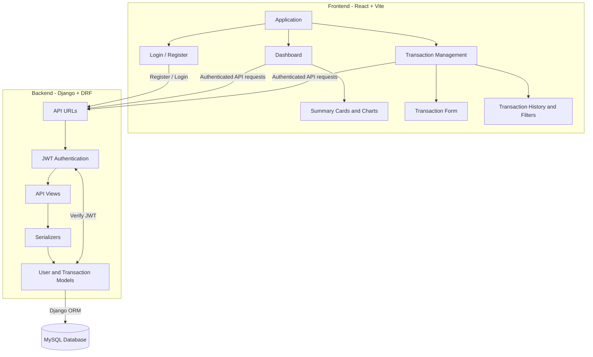
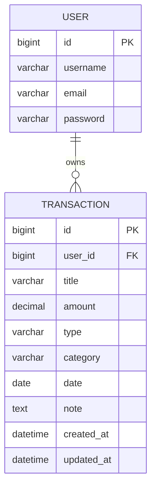
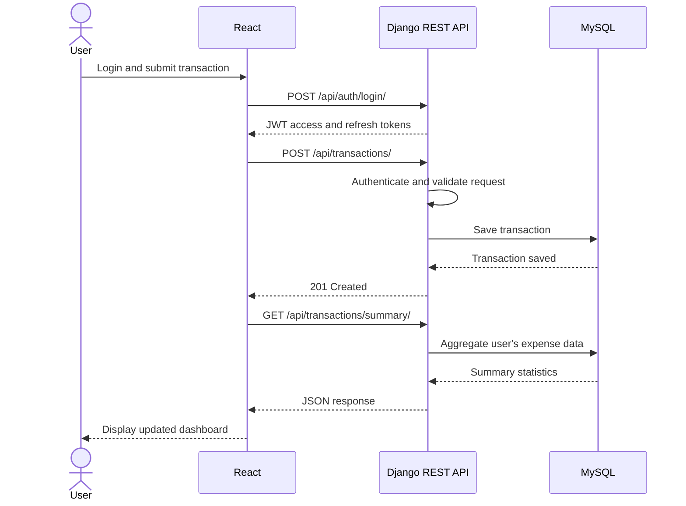

# Personal Expense Tracker

A web application designed to track and manage personal expenses, inspired by SIH26102. This is for a university Django assessment.

---

## Tech Stack

- **Backend:** Django, Django REST Framework, Simple JWT
- **Frontend:** React (Vite)
- **Database Engine:** MySQL (SQLite fallback for local development)

---

## Architecture

The application follows a client-server architecture where a React frontend communicates with a Django REST Framework backend backed by MySQL.

---

## Entity-Relationship Diagram

The relational schema stores user accounts and their associated transaction records.

---

## Setup Guide (since this is a team project)

1. Copy `.env.example` to `.env` in the project root and configure the values.
2. Create and activate a Python virtual environment, then install backend dependencies:
   - `cd backend`
   - `python -m venv .venv`
   - `source .venv/bin/activate`
   - `pip install -r requirements.txt`
3. Run database migrations and start the backend:
   - `python manage.py migrate`
   - `python manage.py runserver`
4. Start the frontend in a separate terminal:
   - `cd frontend`
   - `npm install`
   - `npm run dev`

The backend reads configuration from the root `.env` file. Set `MYSQL_*` variables to use MySQL; if `MYSQL_DATABASE` is not set, SQLite is used for local development.

---

## Application Flow

---

## Authors

- [Saptaparno Chakraborty](https://github.com/schak04)
- [Shubham Singh](https://github.com/Staggered95)

---
